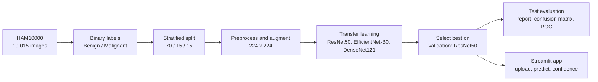

# Automated Skin Cancer Classification

### Deep learning-based dermoscopic image classification on HAM10000

[](https://www.python.org/)
[](https://pytorch.org/)
[](https://streamlit.io/)
[](https://www.isic-archive.com/)

> An end-to-end deep learning system that classifies dermoscopic skin-lesion images as **Benign** or **Malignant**, trained on HAM10000 with transfer learning (ResNet50) and deployed as a Streamlit web app.

### [Launch the live app](https://skin-cancer-classification-zain.streamlit.app/)

<!-- Add after you export them from the notebook, then delete this comment line:


-->

## Results at a glance

Held-out test set: 1,503 images (1,210 benign, 293 malignant).

| Metric | Score |
|---|---:|
| **Test accuracy** | **90.49%** |
| **AUC-ROC** | **0.95** |
| Benign precision / recall / F1 | 0.93 / 0.96 / 0.94 |
| Malignant precision / recall / F1 | 0.80 / 0.68 / 0.74 |
| Macro F1 / Weighted F1 | 0.84 / 0.90 |

**How to read this:** the test set is imbalanced, and a model that predicted "benign" for every image would already score about 80.5% accuracy. The more meaningful signals are AUC-ROC and the malignant-class recall of 0.68, which shows the model still misses a share of malignant lesions. Improving that recall is the main open problem (see [Limitations](#limitations-and-medical-disclaimer)).

## How it works



### Dataset

HAM10000 contains 10,015 dermoscopic images across 7 lesion classes (about 600 x 450 px). It is heavily imbalanced, with melanocytic nevi as the largest class. For this project the 7 classes are grouped into two:

| Class | HAM10000 categories |
|---|---|
| **Benign** | Melanocytic nevi (`nv`), benign keratosis (`bkl`), vascular lesions (`vasc`), dermatofibroma (`df`) |
| **Malignant** | Melanoma (`mel`), basal cell carcinoma (`bcc`), actinic keratosis (`akiec`) |

A stratified split keeps class proportions the same in each subset: **70% train, 15% validation, 15% test**.

### Preprocessing

| Stage | Steps |
|---|---|
| Training | Resize to 224 x 224, random horizontal and vertical flip, random rotation, color jitter, to tensor, ImageNet normalization |
| Validation / test | Resize to 224 x 224, to tensor, ImageNet normalization |

Augmentation is applied only during training.

### Model selection

ResNet50, EfficientNet-B0 and DenseNet121 were compared using transfer learning with a two-class head. **ResNet50** was selected on validation performance.

| Setting | Value |
|---|---|
| Framework | PyTorch / Torchvision |
| Input size | 224 x 224 |
| Batch size | 32 |
| Optimizer | Adam, learning rate 1e-4 |
| Loss | Cross entropy |
| Scheduler | ReduceLROnPlateau |
| Early stopping | Enabled |

## Streamlit app

Upload a dermoscopic image, preview it, and get a Benign or Malignant prediction with confidence information. Images are validated and preprocessed automatically before inference.

**Live:** https://skin-cancer-classification-zain.streamlit.app/

## Run locally

```bash
git clone https://github.com/zaintariq967/Skin-Cancer-Classification.git
cd Skin-Cancer-Classification

python -m venv venv
# Windows:      venv\Scripts\activate
# Linux/macOS:  source venv/bin/activate

pip install -r requirements.txt
streamlit run app.py
```

## Repository structure

```text
Skin-Cancer-Classification/
├── assets/
│   ├── notebook/
│   │   └── Skin-Cancer-Classification_MZainTariq.ipynb
│   ├── srs/
│   │   └── SkinCancer_MZainTariq.pdf
│   ├── model/
│   │   ├── best_resnet50_full.pth
│   │   └── best_resnet50_full.pkl
│   └── test_imgs/
├── app.py
├── main.py
├── evaluate.py
├── requirements.txt
├── README.md
└── .gitignore
```

The dataset is not included because of its size and licensing. Download HAM10000 from the [ISIC Archive](https://www.isic-archive.com/).

## Limitations and medical disclaimer

- **Malignant recall is 0.68.** The model misses roughly one in three malignant lesions in the test set, which matters a lot for a medical task.
- Trained on a single dataset (HAM10000), so it may not generalize to other populations, imaging devices, skin types or clinical settings. No external validation was performed.
- This is an **educational and research prototype**. It is not a diagnostic tool and must not replace professional medical advice. If you have a concerning or changing skin lesion, consult a qualified dermatologist.

**Privacy:** no patient-identifiable information is required, uploaded images are used only for inference and are not intended to be stored, and the pipeline does not depend on paid external APIs.

## Future improvements

- Improve malignant recall (class weighting or resampling, threshold tuning)
- Explainability with Grad-CAM
- Better uncertainty estimation and calibration
- External validation on larger, more diverse datasets
- REST API and mobile app

## References

Tschandl, P., Rosendahl, C., & Kittler, H. (2018). *The HAM10000 dataset, a large collection of multi-source dermatoscopic images of common pigmented skin lesions.* Scientific Data, 5, 180161.

## Author

**Muhammad Zain Tariq**, Computer Engineer | AI/ML | Deep Learning | Computer Vision

[LinkedIn](https://www.linkedin.com/in/mzaintariq967/) | [GitHub](https://github.com/zaintariq967) | [Email](mailto:zaintariq967@gmail.com)
